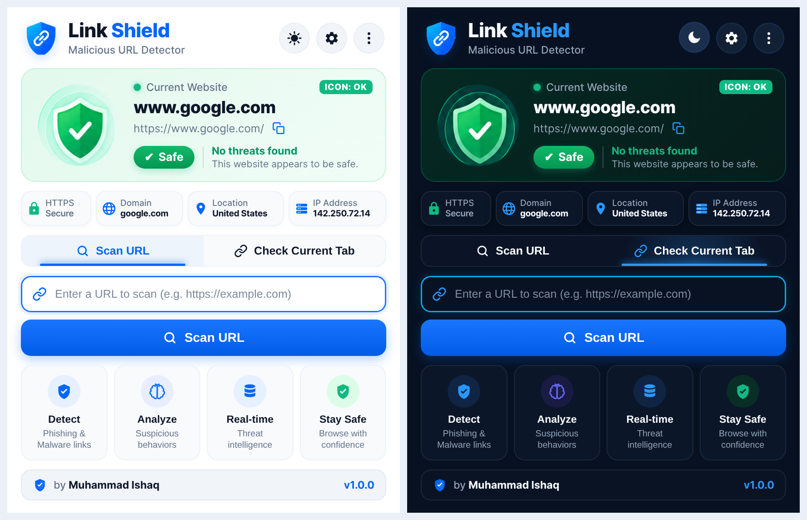
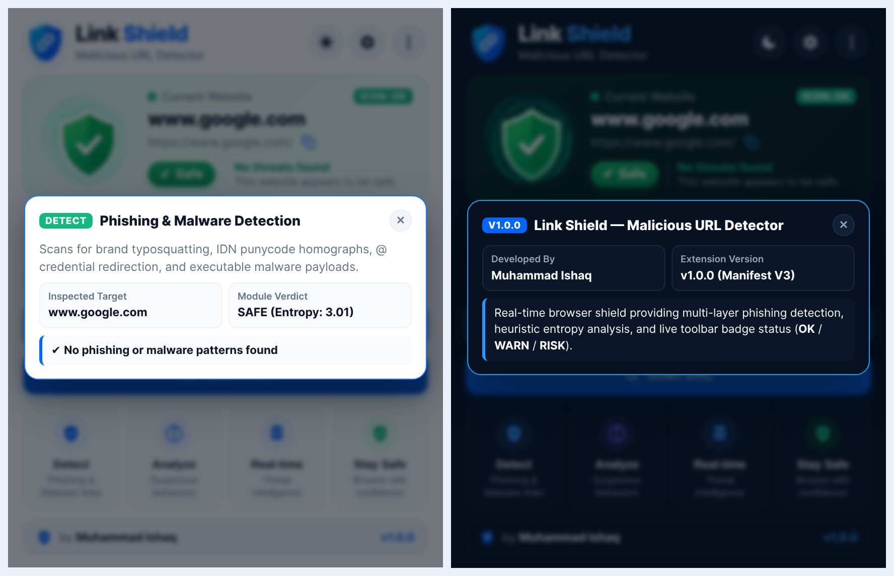

# 🛡️ Link Shield — Malicious URL Detector


**Link Shield** is a lightweight, zero-dependency **Manifest V3 browser extension** (Chrome, Edge, Brave, Opera) that protects users against phishing attacks, brand typosquatting, IDN homograph spoofing, malicious redirects, and unencrypted credential harvesting in real time.

---

## ✨ Preview

### Light & Dark Mode Interface


### Interactive Diagnostic PopUps


---

## 🚀 Key Features

- **Live Toolbar Icon Status Badge**: Displays real-time security verdicts directly on the browser extension icon as you switch tabs or navigate:
  - 🟢 **`OK`** (`#10B981`) — **Safe**: Verified HTTPS connection, clean domain reputation, and zero heuristic anomalies (`Score: 0–24`).
  - 🟠 **`WARN`** (`#F59E0B`) — **Suspicious**: Unencrypted HTTP traffic, obfuscated URL shorteners (`bit.ly`, `tinyurl.com`), open-redirect parameters, high domain entropy, or abused TLDs (`Score: 25–59`).
  - 🔴 **`RISK`** (`#EF4444`) — **Unsafe / Malicious**: Brand typosquatting (`g00gle.com`, `paypa1.com`), subdomain impersonation (`paypal.com.login.tk`), IDN punycode homographs (`xn--`), direct IP hosts, `@` credential redirection, executable downloads (`.exe`, `.pdf.exe`), or XSS/SQLi payloads (`Score: 60–100`).
  - ⚪ **`OFF`** (`#64748B`) — **Paused**: Real-time protection temporarily disabled in Settings.
- **4-Pillar Detection Engine (`detector.js`)**:
  1. **Detect (`Phishing & Malware links`)**: Levenshtein & visual leetspeak typosquatting detection across 35+ protected global brands, IDN Punycode homograph detection, `@` authority spoofing, and dangerous double-extension executable checks.
  2. **Analyze (`Suspicious behaviors`)**: Shannon entropy calculation for Domain Generation Algorithm (DGA) detection, direct IPv4/IPv6/hex host detection, subdomain depth & hyphen density scoring, URL shortener detection, and query injection checks.
  3. **Real-time (`Threat intelligence`)**: Built-in threat feed signatures, high-abuse TLD scoring (`.tk`, `.ml`, `.ga`, `.cf`, `.gq`, `.zip`, `.mov`, `.top`, `.xyz`, `.click`), social-engineering keyword heuristics, DNS-over-HTTPS (`dns.google`) IP resolution, and custom Allowlist/Blocklist overrides.
  4. **Stay Safe (`Browse with confidence`)**: SSL/TLS protocol verification and live DOM inspection (`content.js`) that detects insecure password fields, cross-origin form actions, and displays an optional Shadow-DOM warning banner on dangerous pages.
- **Interactive Floating Info PopUps & Dual Theme UI**:
  - One-click **Light / Dark Mode** toggle with persistent state.
  - Clicking any tab, detail tile (`HTTPS`, `Domain`, `Location`, `IP Address`), or feature card (`Detect`, `Analyze`, `Real-time`, `Stay Safe`) opens a floating diagnostic modal that closes via its `✕` button or by clicking anywhere outside the popup.
  - Zero scrollbars (`overflow: hidden`) and instant JSON threat report export.

---

## 📂 Repository Structure

```text
link-shield/
├── assets/
│   ├── icons/                 # Extension toolbar icons (16x16, 32x32, 48x48, 128x128)
│   └── ui/                    # Brand logo & Light/Dark 3D shield illustrations (Safe, Warn, Danger)
├── docs/
│   └── screenshots/           # UI preview screenshots for documentation
├── tests/
│   └── detector.test.js       # Automated unit & service-worker badge integration test suite
├── .gitignore                 # Git ignore rules for Node, OS, and build artifacts
├── LICENSE                    # MIT License
├── README.md                  # Project documentation
├── background.js              # Manifest V3 Service Worker (live tab monitoring & badge updates)
├── content.js                 # Live DOM inspector & Shadow-DOM in-page warning banner
├── detector.js                # Multi-layer heuristic & threat intelligence URL analysis engine
├── manifest.json              # Chrome Extension Manifest V3 configuration
├── package.json               # Project metadata & test runner script
├── popup.css                  # Light & Dark mode styling (zero-scrollbar layout)
├── popup.html                 # Extension popup markup & floating Info PopUp templates
└── popup.js                   # Popup UI controller & event handlers
```

---

## 🛠️ Installation (Load Unpacked in Chrome / Edge / Brave)

1. Clone or download this repository:
   ```bash
   git clone https://github.com/<your-username>/link-shield.git
   ```
2. Open your Chromium-based browser and navigate to:
   - **Chrome**: `chrome://extensions/`
   - **Edge**: `edge://extensions/`
   - **Brave**: `brave://extensions/`
3. Toggle **Developer mode** ON in the top-right corner.
4. Click **Load unpacked** in the top-left corner and select the `link-shield` project directory.
5. Click the puzzle-piece **Extensions** icon in your browser toolbar and **Pin** **Link Shield** to view the live **`OK` / `WARN` / `RISK`** status badge while browsing.

---

## 🧪 Running Automated Tests

Link Shield includes a zero-dependency Node.js unit and integration test suite that validates the heuristic scoring engine (`detector.js`) and service-worker badge synchronization (`background.js`):

```bash
npm test
# or directly:
node tests/detector.test.js
```

---

## 👤 Author

**Muhammad Ishaq**
- Version: `v1.0.0`
- License: [MIT](LICENSE)
